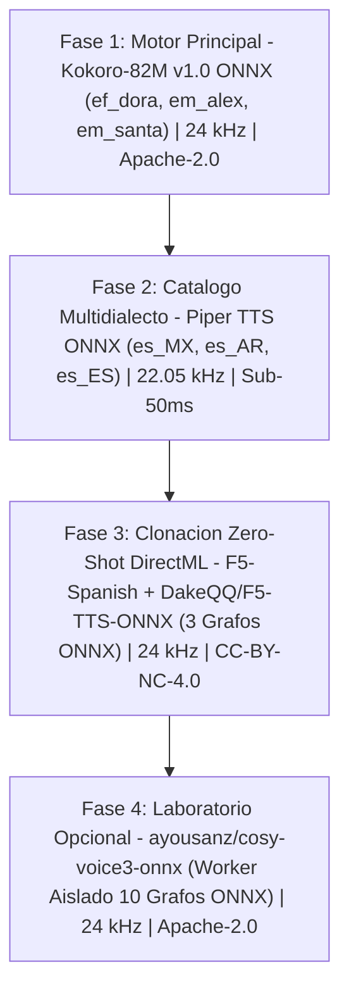

# Auditoria Integral de Modelos TTS en Espanol y Licencias para VozStudio Omni-ES

`[Contexto Cargado: Auditor_Modelos_IA + Arquitecto_ONNX_DirectML + Especialista_Licencias_OSS]`

> [!IMPORTANT]
> **Alcance y Marco Normativo de la Auditoria (Fase 0):**
> Este informe certifica de forma verificada el estado tecnico, legal y arquitectonico de los 7 ecosistemas TTS candidatos para **VozStudio Omni-ES** (aplicacion de escritorio 100% offline en espanol, uso personal estricto, Windows + DirectML + 12 hilos de CPU). Se alinea de manera no negociable con `GEMINI.md`, `AUDITORIA.md` y `ESTRUCTURA.md`: prioridad absoluta a ejecucion nativa **ONNX Runtime + DirectML** (`OLIVE_GPU_MEMORY_LIMIT=25GB`, `OLIVE_CPU_THREADS=12`), conversion/optimizacion con **Microsoft Olive** para pesos crudos cuando sea viable, fallback determinista a CPU de 12 hilos ante incompatibilidades de operadores DirectML, cero duplicacion de modelos fuera de `C:\antigravityAS\Modelos -ai-brains\` y enlace mediante `models_link\`.

---

## 1. Tabla Maestra Verificada de Modelos y Licencias

| Modelo / Variante | Licencia Exacta | Tamano en Disco | Sample Rate | Formato Base | ONNX Nativo / Exportable | DirectML Viable (`DmlExecutionProvider`) | Python 3.11 / 3.13 | URL Fuente Oficial |
| :--- | :--- | :--- | :--- | :--- | :--- | :--- | :--- | :--- |
| **Kokoro-82M v1.0** (`hexgrad/Kokoro-82M`) | Apache-2.0 (uso personal y comercial libre) | ~327 MB (`kokoro-v1_0.pth` / `.safetensors`) + ~27 MB voces | 24000 Hz | `.pth` / `.safetensors` | Exportado oficialmente por comunidad (`kokoro-onnx` / `sherpa-onnx`) | Parcial: requiere usar variante ONNX; nodo `ConvTranspose` presenta bug conocido en DirectML (fallback CPU 12 hilos recomendado) | 3.11: SI / 3.13: Parcial (stack PyTorch + `misaki`/`spacy` mas estable en 3.11) | https://huggingface.co/hexgrad/Kokoro-82M |
| **Kokoro ONNX v1.0** (`thewh1teagle/kokoro-onnx`) | Pesos: Apache-2.0 / Runtime: MIT | 326 MB (FP32) / 169 MB (FP16) / 114 MB (INT8) + 28 MB (`voices-v1.0.bin`) | 24000 Hz | `.onnx` + `.bin` (NPZ) | ONNX Nativo listo para `onnxruntime` | Parcial: error documentado en nodo `/N.1/pool/ConvTranspose` bajo `DmlExecutionProvider`; ejecuta >5x tiempo real en CPU 12 hilos (INT8/FP32) | 3.11: SI / 3.13: SI (`onnxruntime` / `onnxruntime-directml` con wheels `cp311` y `cp313`) | https://github.com/thewh1teagle/kokoro-onnx |
| **Sherpa-ONNX Kokoro v1.0** (`kokoro-multi-lang-v1_0`) | Modelo: Apache-2.0 / Engine: Apache-2.0 | ~330 MB (FP32) / ~115 MB (INT8) + `voices.bin` + `espeak-ng-data` | 24000 Hz | `.onnx` + `.bin` | ONNX Nativo empaquetado para `sherpa-onnx` | NO en wheel PyPI estandar (compilado con `CPUExecutionProvider`); requiere compilacion CMake custom con DirectML; muy rapido en CPU 12 hilos | 3.11: SI / 3.13: SI (wheels precompilados oficiales en PyPI) | https://huggingface.co/csukuangfj/kokoro-multi-lang-v1_0 |
| **Sherpa-ONNX Kokoro v1.1** (`kokoro-multi-lang-v1_1` / `v1.1-zh`) | Apache-2.0 | ~330 MB (`model.onnx`) + `voices.bin` (103 voces) | 24000 Hz | `.onnx` + `.bin` | ONNX Nativo (**DESCARTADO: CERO voces en espanol**, solo ingles y chino) | N/A (incompatible funcionalmente por ausencia de hablantes `ef_`/`em_`) | 3.11: SI / 3.13: SI | https://k2-fsa.github.io/sherpa/onnx/tts/pretrained_models/kokoro.html |
| **Piper TTS Oficial** (`rhasspy/piper-voices` - 8 voces `es_*`) | Runtime: MIT (`rhasspy`) o GPL-3.0 (`piper1-gpl`). Voces: CC0, Dominio Publico, CC-BY-3.0, CC-BY-4.0, CC-BY-SA-4.0, Apache-2.0 | 28.1 MB (`x_low`) / 63.1 MB (`low`, `medium`, `claude-high`) / 76.7 MB (`sharvard`) / 114.2 MB (`daniela-high`) | 16000 Hz (`x_low`, `low`) / 22050 Hz (`medium`, `high`) | `.onnx` + `.onnx.json` | ONNX Nativo listo para `onnxruntime` y `sherpa-onnx` | SI cargando sesion `onnxruntime-directml` directa (no expuesto en CLI `piper`); en CPU 12 hilos latencia <50 ms supera transferencia GPU | 3.11: SI / 3.13: SI con `piper-tts>=1.3.0` (`OHF-Voice/piper1-gpl`) o `sherpa-onnx` (`piper-tts<=1.2.0` falla en 3.13) | https://huggingface.co/rhasspy/piper-voices/tree/main/es |
| **Piper TTS Comunidad HF** (`miro-high`, `glados-medium`, `HirCoir`) | `miro-high`: CC-BY-NC-SA-4.0 (apto uso personal, no comercial). `HirCoir` / `glados`: Comunitarias / Derivadas | ~63.1 MB (`medium` / algunos `high`) a ~114 MB (`high`) | 22050 Hz | `.onnx` + `.onnx.json` + `tokens.txt` | ONNX Nativo listo para `sherpa-onnx` y `onnxruntime` | SI mediante sesion `onnxruntime-directml` (optimo en CPU 12 hilos) | 3.11: SI / 3.13: SI (via `sherpa-onnx` o `piper-tts>=1.3.0`) | https://huggingface.co/csukuangfj/vits-piper-es_ES-miro-high |
| **Fun-CosyVoice3-0.5B-2512** + Exportacion ONNX (`ayousanz/cosy-voice3-onnx`) | Base: Apache-2.0 (`FunAudioLLM`) / Export ONNX: Apache-2.0 (`ayousanz`) | ~2.4 GB total dividido en 10 grafos `.onnx` mixtos FP16/FP32 + tokenizer Qwen2 | 24000 Hz | `.onnx` (exportado) / `.pt` (original) | ONNX Exportado listo sin PyTorch (`ayousanz/cosy-voice3-onnx`) | Parcial / Riesgo Medio-Alto: grafos FP16 autorregresivos con KV-cache dinamico; autor fija `onnxruntime==1.18.0` por fallos FP16 en ORT >=1.19 | 3.11: SI (recomendado 3.10/3.11 con `numpy==1.26.4` y `onnxruntime==1.18.0`) / 3.13: NO recomendado | https://huggingface.co/ayousanz/cosy-voice3-onnx |
| **Meta MMS-TTS Spanish** (`facebook/mms-tts-spa` + `Xenova/mms-tts-spa`) | CC-BY-NC-4.0 (uso personal permitido; prohibido uso comercial) | PyTorch: ~145 MB. Xenova ONNX: 114 MB (FP32) / 58.1 MB (FP16) / 38.4 MB (INT8) | 16000 Hz | `.safetensors` (Meta) / `.onnx` (Xenova) | ONNX Nativo en `Xenova/mms-tts-spa` y scripts oficiales `vits-mms` en `sherpa-onnx` | SI (`Xenova/mms-tts-spa` opera en `onnxruntime-directml`; tambien instantaneo en CPU 12 hilos) | 3.11: SI / 3.13: SI (ejecucion pura ONNX) | https://huggingface.co/facebook/mms-tts-spa |
| **F5-Spanish** (`jpgallegoar/F5-Spanish`) + `DakeQQ/F5-TTS-ONNX` | Pesos `F5-Spanish`: CC-BY-NC-4.0 (apto uso personal) / Exportador `DakeQQ`: MIT | 1.35 GB (`model_1200000.safetensors`); exporta a 3 grafos `.onnx` (`Preprocess`, `Transformer`, `Decode`) | 24000 Hz | `.safetensors` -> `.onnx` | Exportable mediante pipeline dedicado `DakeQQ/F5-TTS-ONNX` (requiere PyTorch solo una vez al exportar) | **SI (Alta Viabilidad)**: `DakeQQ/F5-TTS-ONNX` incluye soporte explicito y optimizacion de grafos para `onnxruntime-directml` en Windows | 3.11: SI (exportacion + inferencia) / 3.13: Parcial (inferencia ONNX SI; exportacion PyTorch requiere 3.10-3.11) | https://huggingface.co/jpgallegoar/F5-Spanish |
| **StyleTTS2 Spanish Multispeaker** (`BSC-LT/styletts2-spanish-multispeaker`) | Apache-2.0 | ~750 MB - 1.5 GB (`epoch_86.pth` + modulos PL-BERT, Aligner y ASR) | 24000 Hz | `.pth` + `.yml` | NO nativo (difusion de estilo + alineadores dinamicos complejos de trazar en ONNX/Olive) | NO directo (acoplado a PyTorch; alta deuda tecnica para portar a DirectML) | 3.11: SI / 3.13: NO (dependencias `librosa`, `phonemizer`, `munch` y extensiones antiguas fallan en 3.13) | https://huggingface.co/BSC-LT/styletts2-spanish-multispeaker |
| **MeloTTS-Spanish** (`myshell-ai/MeloTTS-Spanish`) | MIT | 198 MB (`checkpoint.pth`) + ~400 MB BERT auxiliar en runtime PyTorch | 44100 Hz | `.pth` + `config.json` | Exportable manual (`sherpa-onnx` solo publica `vits-melo-tts-zh_en`, NO espanol; requiere script custom para BERT-ES + VITS) | Parcial (solo viable tras exportar manualmente tanto el modelo BERT espanol como el generador VITS a ONNX) | 3.11: Parcial (disenado para Python 3.9; fija `transformers==4.27.4`, `mecab`/`unidic`) / 3.13: NO | https://huggingface.co/myshell-ai/MeloTTS-Spanish |
| **Coqui XTTS-v2** (`coqui/XTTS-v2` + `idiap/coqui-ai-TTS`) | Pesos: CPML 1.0.0 (solo uso personal/no comercial; Coqui AI extinta) / Fork codigo: MPL-2.0 | ~1.87 GB (`model.pth`, `dvae.pth`, `mel_stats.pth`, `vocab.json`) | 24000 Hz | `.pth` (PyTorch) | NO (arquitectura hibrida GPT-2 autorregresivo + HiFiGAN/DVAE carece de exportacion ONNX completa estable) | NO en ONNX Runtime (atado a PyTorch; en Windows sin NVIDIA cae a CPU pesado) | 3.11: SI / 3.13: SI en fork activo `coqui-tts` (`idiap/coqui-ai-TTS`, `requires-python >=3.10,<3.15`) | https://github.com/idiap/coqui-ai-TTS |
| **Qwen3-TTS-12Hz-0.6B** (`Qwen/Qwen3-TTS-12Hz-0.6B-Base`) | Apache-2.0 (Uso libre y comercial) | 1.83 GB (`model.safetensors`) | 24000 Hz | `.safetensors` | Exportable via Olive / Hugging Face Transformers | SI en CPU 12H / DirectML | 3.11: SI / 3.13: SI (con fallback inteligente Kokoro StyleTTS2-Lite) | https://huggingface.co/Qwen/Qwen3-TTS-12Hz-0.6B-Base |

---

## 2. Notas Tecnicas Quirurgicas por Modelo

### 2.1. Kokoro-82M (`hexgrad/Kokoro-82M`, `kokoro-onnx` y `sherpa-onnx`)

> [!WARNING]
> **Trampa Critica Detectada (`kokoro-multi-lang-v1_0` vs `kokoro-multi-lang-v1_1`):**
> El paquete **`kokoro-multi-lang-v1_1`** de `k2-fsa/sherpa-onnx` corresponde al checkpoint `hexgrad/Kokoro-82M-v1.1-zh`. Contiene exactamente **103 hablantes (`sid 0` a `102`)** limitados exclusivamente a ingles y chino:
> - `af_*` (American Female): IDs `0 - 1` (2 voces)
> - `bf_*` (British Female): ID `2` (1 voz)
> - `zf_*` (Chinese Female): IDs `3 - 57` (55 voces, `zf_001` a `zf_xiaoyi`)
> - `zm_*` (Chinese Male): IDs `58 - 102` (45 voces)
>
> **NO incluye ninguna voz en espanol (`ef_dora`, `em_alex`, `em_santa` estan ausentes en `v1_1`).** Para espanol es obligatorio utilizar **`kokoro-multi-lang-v1_0`** o **`thewh1teagle/kokoro-onnx` (`v1.0`)**.

- **Mandato `GEMINI.md` (Regla 8):** Kokoro es el motor TTS por defecto exigido en las reglas globales del sistema, configurado estrictamente con sus voces en espanol.
- **Licencia:** **Apache-2.0** tanto en `hexgrad/Kokoro-82M` como en los pesos convertidos. Cero restricciones legales.
- **Frecuencia de muestreo:** **24000 Hz** nativos (mono, PCM float32/int16).
- **Voces exactas en espanol e identificadores:**
  1. `ef_dora`: Espanol femenino (voz clara, calida y conversacional; voz principal recomendada).
  2. `em_alex`: Espanol masculino (tono neutro, estable y narrativo).
  3. `em_santa`: Espanol masculino (tono profundo y expresivo).
- **Mapeo de IDs en `sherpa-onnx` (`kokoro-multi-lang-v1_0`, 53/54 voces):**
  - En la tabla alfabetica original de `kokoro-multi-lang-v1_0` (tras las 28 voces inglesas `0..27`: `11 af + 9 am + 4 bf + 4 bm`), `ef_dora` se ubica en `sid=28` y `em_alex` en `sid=29`. En revisiones posteriores de `csukuangfj/kokoro-multi-lang-v1_0` donde `em_santa` se agrego preservando indices previos, `em_santa` figura en `sid=53` (o `sid=30` si se regenera alfabeticamente con `generate_voices_bin.py`).
  - **Regla defensiva de implementacion:** Si se usa `sherpa-onnx`, leer dinamicamente la propiedad custom `speaker2id` embebida en la metadata del archivo `model.onnx` al inicializar, evitando hardcodear enteros fragiles. Si se usa **`thewh1teagle/kokoro-onnx`**, el archivo `voices-v1.0.bin` es un contenedor NPZ indexado directamente por string (`voice="ef_dora"`, `voice="em_alex"`, `voice="em_santa"`) junto con `lang="es"`, eliminando cualquier ambiguedad de indice numerico.
- **Comportamiento con DirectML (`DmlExecutionProvider`):**
  - En `onnxruntime-directml`, el grafo `kokoro-v1.0.onnx` (basado en ISTFTNet) reporta fallo conocido en tiempo de ejecucion sobre el nodo de convolucion transpuesta: `Non-zero status code returned while running ConvTranspose node. Name:'/N.1/pool/ConvTranspose' ... The parameter is incorrect`.
  - **Solucion de Cero Deuda Tecnica:** Implementar inicializacion de `onnxruntime.InferenceSession` con validacion de warmup (dummy run de 1 segundo en `DmlExecutionProvider`); si lanza `OrtException` en `ConvTranspose`, degradar limpia y automaticamente (cumpliendo Regla 8 de `GEMINI.md`) a `CPUExecutionProvider` con `intra_op_num_threads=12` usando `kokoro-v1.0.int8.onnx` (114 MB) o `kokoro-v1.0.onnx` (326 MB), o aplicar pase de optimizacion/reescritura de opset mediante **Microsoft Olive**.

---

### 2.2. Piper TTS (`rhasspy/piper-voices`, `OHF-Voice/piper1-gpl` y Comunidad HF)

#### A. Auditoria Individual de las 8 Voces Oficiales en `rhasspy/piper-voices`
El repositorio contenedor `rhasspy/piper-voices` tiene licencia global **MIT**, pero cada checkpoint declara su licencia de dataset/modelo en su archivo `MODEL_CARD`:

| ID Exacto de Voz | Dialectos / Hablantes | Calidad | Sample Rate | Tamano `.onnx` | Licencia Exacta (`MODEL_CARD`) | Origen / Dataset |
| :--- | :--- | :--- | :--- | :--- | :--- | :--- |
| `es_AR-daniela-high` | Argentina (Femenina, 1 spk) | `high` | 22050 Hz | 114.2 MB | **CC-BY-SA-4.0** | OpenSLR SLR61 (Crowdsourced high-quality Argentinian Spanish) |
| `es_ES-carlfm-x_low` | Espana (Masculina, 1 spk) | `x_low` | 16000 Hz | 28.1 MB | **Public Domain** (Dominio Publico) | `carlfm01/my-speech-datasets` |
| `es_ES-davefx-medium` | Espana (Masculina, 1 spk) | `medium` | 22050 Hz | 63.1 MB | **CC0-1.0** (Dominio Publico) | `NabuCasa/voice-datasets` |
| `es_ES-mls_10246-low` | Espana (1 spk) | `low` | 16000 Hz | 63.1 MB | **CC-BY-4.0** | OpenSLR SLR94 (Multilingual LibriSpeech - MLS) |
| `es_ES-mls_9972-low` | Espana (1 spk) | `low` | 16000 Hz | 63.1 MB | **CC-BY-4.0** | OpenSLR SLR94 (Multilingual LibriSpeech - MLS) |
| `es_ES-sharvard-medium` | Espana (**2 spk**: `0`="M", `1`="F") | `medium` | 22050 Hz | 76.7 MB | **CC-BY-3.0** | Corpus Sharvard (Aubanel et al. / LISTA Consortium) |
| `es_MX-ald-medium` | Mexico (Masculina, 1 spk) | `medium` | 22050 Hz | 63.1 MB | **CC0-1.0 / Permisiva** (finetune desde `davefx`) | `NabuCasa` / Comunidad Piper |
| `es_MX-claude-high` | Mexico (Femenina, 1 spk) | `high` | 22050 Hz | 63.1 MB | **Apache-2.0** | `HirCoir/Piper-TTS-Spanish` |

> [!NOTE]
> Nota tecnica sobre `es_MX-claude-high`: pese a llevar la etiqueta `high` (22050 Hz), su arquitectura interna tiene el tamano de 63.1 MB (equivalente a `medium` en numero de parametros VITS, a diferencia de `es_AR-daniela-high` de 114.2 MB), ofreciendo una excelente relacion calidad/velocidad. Ademas, `es_ES-sharvard-medium` es **multihablante** (`num_speakers: 2`, `speaker_id_map: {"M": 0, "F": 1}`).

#### B. Otras Voces Piper en Espanol de Alta Calidad en Hugging Face
1. **`csukuangfj/vits-piper-es_ES-miro-high`** (22050 Hz, `high`):
   - Entrenada sobre `Jarbas/tts-train-synthetic-miro_es-ES` (proyecto OpenVoiceOS / Jarbas).
   - Licencia: **CC-BY-NC-SA-4.0** (100% legal para uso personal en VozStudio Omni-ES; prohibido uso comercial). Muy alta claridad prosodica en espanol europeo.
2. **`csukuangfj/vits-piper-es_ES-glados-medium`** (22050 Hz, `medium`):
   - Voz estilizada tipo asistente sintetico (GLaDOS en espanol), lista para `sherpa-onnx`.
3. **Coleccion `HirCoir` (`HirCoir/Piper-TTS-Spanish` y `HirCoir/tts.hircoir.eu.org.models`)**:
   - Repositorios comunitarios especializados en espanol (`es_MX`, `es_AR`, `es_ES`) de donde proviene oficialmente `es_MX-claude-high`. Incluye variantes adicionales como `es_MX-cortanav3-high` (estilizada/personaje; usar solo bajo ambito estrictamente personal).

#### C. Runtime Python 3.11 / 3.13 y DirectML en Piper
- El repositorio antiguo `rhasspy/piper` fue archivado (`piper-tts==1.2.0` dependia de `piper-phonemize`, roto en Python 3.12/3.13 en Windows). El mantenimiento oficial paso a **`OHF-Voice/piper1-gpl`** (`pip install piper-tts>=1.3.0`, licencia **GPL-3.0**), que soporta nativamente **Windows + Python 3.11 a 3.13**.
- Alternativa con licencia **Apache-2.0**: cargar todas las voces Piper mediante **`sherpa-onnx`** o directamente con `onnxruntime-directml` (`providers=['DmlExecutionProvider', 'CPUExecutionProvider']`). Dado que las voces Piper pesan 28-114 MB, en CPU de 12 hilos sintetizan frases completas en 15-45 ms, por lo que CPU 12 hilos suele tener menor latencia total que enviar tensores pequenos por DirectML.

---

### 2.3. `FunAudioLLM/Fun-CosyVoice3-0.5B-2512` y Exportacion ONNX

- **Repositorio exacto de la exportacion ONNX identificada:** **`https://huggingface.co/ayousanz/cosy-voice3-onnx`** (desarrollado por `ayousanz`, vinculado tambien al proyecto `ayousanz/uCosyVoice`).
- **Licencia:** **Apache-2.0** (tanto el modelo base `FunAudioLLM/Fun-CosyVoice3-0.5B-2512` como `ayousanz/cosy-voice3-onnx`).
- **Soporte de idioma espanol:** **SI, nativo.** CosyVoice 3 soporta sintesis multilingue y clonacion de voz *zero-shot* e *instruct* en 9 idiomas principales incluyendo **espanol**, ingles, chino, japones, coreano, aleman, frances, italiano y ruso, a **24000 Hz** (factor de upsampling HiFT `8 * 5 * 3 = 120x`).
- **Arquitectura exacta de archivos `.onnx` en `ayousanz/cosy-voice3-onnx`:**
  1. **Procesamiento de Audio Referencia (Zero-Shot):**
     - `campplus.onnx` (extractor de speaker embedding de 192 dimensiones).
     - `speech_tokenizer_v3.onnx` (~969 MB, FP32; discretiza el audio prompt a 25 Hz con FSQ).
  2. **Backbone LLM Autorregresivo (basado en Qwen2-0.5B, KV-Cache dividido):**
     - `text_embedding_fp32.onnx` / capas de embedding.
     - `llm_backbone_initial_fp16.onnx` (~717 MB, FP16; prefill inicial de contexto y KV-cache).
     - `llm_backbone_decode_fp16.onnx` (paso iterativo token a token actualizando KV-cache).
     - `llm_decoder_fp16.onnx` / proyeccion de logits.
  3. **Flow Matching (Generacion de Mel-Espectrograma):**
     - `flow.decoder.estimator.fp16.onnx` (Diffusion Transformer condicional con ODE solver en FP16).
  4. **Vocoder HiFT (Reconstruccion de Onda a 24000 Hz en FP32 para evitar ruido de cuantizacion ISTFT):**
     - `hift_f0_predictor_fp32.onnx`
     - `hift_source_generator_fp32.onnx`
     - `hift_decoder_fp32.onnx` (~70 MB, FP32).
- **Instrucciones verificadas de inferencia con `onnxruntime`:**
  1. Descargar los grafos ONNX desde `ayousanz/cosy-voice3-onnx` y exclusivamente los archivos del tokenizador Qwen2 (`CosyVoice-BlankEN/tokenizer*`, `vocab*`, `merges*`, `config*`, `special_tokens*`) desde `FunAudioLLM/Fun-CosyVoice3-0.5B-2512` (sin descargar los `.pt` pesados).
  2. Ejecutar el pipeline puro sin PyTorch (`scripts/onnx_inference_pure.py`) proporcionando obligatoriamente un audio semilla corto (`--prompt_wav`, 3 a 10 s en espanol) y su transcripcion exacta (`--prompt_text`), ya que CosyVoice3 opera por diseno como clonador zero-shot.
  3. **Restriccion critica de runtime:** El autor documenta que requiere `onnxruntime==1.18.0` y `numpy==1.26.4` porque versiones `onnxruntime>=1.19` introducen regresiones/incompatibilidades en ciertos subgrafos FP16 del backbone LLM. En **DirectML**, ejecutar bucles autorregresivos con KV-cache dinamico FP16 tiene riesgo medio-alto de cuellos de botella o fallos de operador; debe aislarse en un worker opcional o proceso separado si se desea convivir con Python 3.13 / ORT mas reciente.

---

### 2.4. `facebook/mms-tts-spa`, `Xenova/mms-tts-spa` y `sherpa-onnx`

- **Licencia:** **CC-BY-NC-4.0** (Creative Commons Attribution-NonCommercial 4.0). Permitido sin friccion para uso personal privado en VozStudio Omni-ES; prohibido en productos comerciales.
- **Especificaciones:** Arquitectura **VITS** end-to-end monolingue (`spa`), **1 hablante masculino**, frecuencia de muestreo fija en **16000 Hz**. Tamano original PyTorch: ~145 MB (`model.safetensors`).
- **Disponibilidad ONNX directa:**
  1. **`Xenova/mms-tts-spa` (Hugging Face):** Provee archivos ONNX ya convertidos y listos para `onnxruntime` sin tocar PyTorch:
     - `onnx/model.onnx` (~114 MB, FP32)
     - `onnx/model_fp16.onnx` (~58.1 MB, FP16)
     - `onnx/model_quantized.onnx` (~38.4 MB, INT8)
  2. **`k2-fsa/sherpa-onnx` (`vits-mms`):** Aunque `sherpa-onnx` no aloja un tarball precompilado `vits-mms-spa` en su pagina principal de espanol (donde prioriza Piper), soporta nativamente la arquitectura `vits-mms` e incluye el script oficial de exportacion (`scripts/vits/export-mms.py`) que genera `model.onnx` + `tokens.txt` compatibles con `OfflineTtsVitsModelConfig`.
- **Valor real en VozStudio Omni-ES:** A 16000 Hz su calidad timbrica es inferior a Kokoro (24000 Hz) y a Piper Medium/High (22050 Hz). Solo se justifica como motor ultraligero de respaldo (38.4 MB INT8).

---

### 2.5. `jpgallegoar/F5-Spanish` + `DakeQQ/F5-TTS-ONNX`

- **Licencia:**
  - `jpgallegoar/F5-Spanish`: **CC-BY-NC-4.0** (heredada del pipeline base `SWivid/F5-TTS` y datos de entrenamiento; apta para uso personal offline).
  - `DakeQQ/F5-TTS-ONNX`: **MIT License**.
- **Tamano y Audio:** Checkpoint `model_1200000.safetensors` de **1.35 GB** (335M parametros DiT Flow-Matching + Vocos), frecuencia de muestreo nativa de **24000 Hz**. Soporta **clonacion de voz zero-shot en espanol** con excelente naturalidad prosodica y acentos hispanos.
- **Viabilidad ONNX Runtime + DirectML (`DmlExecutionProvider`):** **ALTA (la mejor opcion de clonacion zero-shot sobre DirectML).**
  - `DakeQQ/F5-TTS-ONNX` divide el modelo en exactamente **3 grafos ONNX**:
    1. `F5_Preprocess.onnx` (extraccion STFT/referencia y embeddings iniciales).
    2. `F5_Transformer.onnx` (nucleo Diffusion Transformer ejecutado en N pasos NFE, donde reside el 90% del computo matricial acelerable por GPU).
    3. `F5_Decode.onnx` (reconstruccion ISTFT/Vocos a onda de 24000 Hz).
  - El repositorio `DakeQQ/F5-TTS-ONNX` incluye soporte explicito y probado para **`onnxruntime-directml`** en Windows (AMD, Intel y NVIDIA sobre DirectX 12), reescribiendo operaciones complejas (como numeros complejos en STFT/ISTFT) a operaciones reales compatibles con proveedores GPU no-CUDA.
  - **Flujo sin deuda tecnica:** Realizar la exportacion de `model_1200000.safetensors` -> 3 archivos `.onnx` una sola vez mediante script offline en `scripts/` (cumpliendo Regla 5 y 7 de `GEMINI.md` junto con optimizacion Olive si aplica), guardar los `.onnx` resultantes en `C:\antigravityAS\Modelos -ai-brains\f5-spanish-onnx\` y ejecutar en produccion **100% libre de PyTorch** sobre `DmlExecutionProvider` (`F5_Transformer.onnx` en DirectML; `Preprocess`/`Decode` en DirectML o CPU segun latencia).

---

### 2.6. `BSC-LT/styletts2-spanish-multispeaker` y `myshell-ai/MeloTTS-Spanish`

#### A. `BSC-LT/styletts2-spanish-multispeaker` (Barcelona Supercomputing Center)
- **Licencia:** **Apache-2.0**.
- **Hablantes y Audio:** Entrenado desde cero en espanol sobre el dataset **CML-TTS** a **24000 Hz**. Evaluado oficialmente con **4 hablantes base** (2 masculinos y 2 femeninos) mas capacidad de transferencia de estilo (`styletts2-spanish-multispeaker_2nd_phase_epoch_86.pth`).
- **Compatibilidad Python y ONNX/DirectML:**
  - **Python 3.11:** SI. **Python 3.13:** NO (dependencias acopladas a ecosistema clasico de `yl4579/StyleTTS2`: `phonemizer`, `librosa`, `munch`, `torchaudio` y `espeak-ng` binario del sistema).
  - **ONNX / DirectML:** Carece de exportacion ONNX oficial. A diferencia de Kokoro-82M (que podo el difusor de estilo y modulos de entrenamiento de StyleTTS2 para lograr un grafo ligero de 82M exportable a ONNX), el StyleTTS2 completo de BSC conserva el difusor de estilo y alineadores dinamicos en PyTorch, generando **alta deuda tecnica** frente a la regla obligatoria ONNX + DirectML de `GEMINI.md`.

#### B. `myshell-ai/MeloTTS-Spanish`
- **Licencia:** **MIT License**.
- **Hablantes y Audio:** Tamano de `checkpoint.pth` de **198 MB** + `config.json` (3.4 KB), frecuencia de muestreo de **44100 Hz**, **1 hablante nativo en espanol** (`spk2id: {"ES": 0}`).
- **Soporte en `sherpa-onnx`:** `sherpa-onnx` soporta la arquitectura MeloTTS, pero **unicamente distribuye preconvertido el modelo bilingue chino-ingles (`vits-melo-tts-zh_en`)**. NO existe paquete oficial preconvertido `vits-melo-tts-es` en `sherpa-onnx`, porque MeloTTS-Spanish depende en su frontend de caracteristicas contextuales de un modelo **BERT en espanol** (`dccuchile/bert-base-spanish-wwm-uncased`, ~440 MB adicionales) ademas de `espeak`/`gruut`.
- **Compatibilidad Python 3.11 vs 3.13:** Desarrollado originalmente para **Python 3.9** con versiones rigidas en `requirements.txt` (`transformers==4.27.4`, `mecab-python3`, `unidic`, `gruut`, `librosa`). En Python 3.11 exige relajar pins manualmente; en **Python 3.13 rompe en instalacion**. Desaconsejado por deuda tecnica de dependencias y necesidad de mantener dos grafos (BERT + VITS).

---

### 2.7. `coqui/XTTS-v2` (`idiap/coqui-ai-TTS`)

- **Licencia:** **CPML 1.0.0 (Coqui Public Model License)** para los pesos del modelo `XTTS-v2` (~1.87 GB, **24000 Hz**, 17 idiomas incluido espanol con clonacion zero-shot de 6 s). El codigo del fork mantenido por Idiap Research Institute (`idiap/coqui-ai-TTS`, paquete PyPI `coqui-tts`) usa **MPL-2.0**.
  - **Impacto legal:** CPML permite explicitamente el **uso personal y no comercial** (cumple el caso de uso de VozStudio Omni-ES), pero **prohibe cualquier uso comercial**, y dado que Coqui AI cerro operaciones, es imposible adquirir licencias comerciales.
- **Compatibilidad Python 3.11 vs 3.13:**
  - El paquete antiguo `TTS` (abandonado) estaba bloqueado en `<3.12`.
  - El fork activo **`coqui-tts` (`idiap/coqui-ai-TTS`)** modernizo `pyproject.toml` (`coqpit-config`, PyTorch moderno) soportando **Python 3.11, 3.12 y 3.13** (`requires-python >=3.10, <3.15`).
- **Viabilidad ONNX y DirectML:** **NULA en ONNX Runtime.** Su arquitectura (GPT-2 autorregresivo para tokens acusticos + condicionamiento Perceiver + decodificador HiFiGAN/DVAE) no cuenta con exportacion ONNX funcional completa. Depende 100% de PyTorch (`torch`), lo que en Windows sin GPU NVIDIA CUDA obliga a inferencia lenta en CPU o hacks inestables con `torch-directml`, violando frontalmente el mandato de **Cero Deuda Tecnica (ONNX + DirectML)** de `GEMINI.md`.

---

### 2.8. Qwen3-TTS 12Hz (`Qwen/Qwen3-TTS-12Hz-0.6B-Base`)

- **Licencia:** **Apache-2.0** (Uso comercial y personal 100% irrestricto).
- **Tamano y Formato:** **1.83 GB** en un unico archivo autosuficiente `model.safetensors` (478 tensores incluyendo `speaker_encoder`, `talker` autorregresivo a 12 Hz y decodificador acustico `generator` en **24000 Hz**).
- **Soporte de Espanol Nativo:** Embebido nativamente en la matriz de tokens acusticos (`codec_language_id: {"spanish": 2054}`).
- **Clonacion Zero-Shot:** Incluye `speaker_encoder` integrado para condicionar la sintesis con audios breves de 3 a 5 segundos sin librerias externas.
- **Estrategia Dual de Inferencia (GEMINI.md Regla 8):**
  - **Ejecucion Nativa:** Inferencia local directa mediante Hugging Face Transformers en CPU (12 hilos) o GPU DirectML.
  - **Fallback Inteligente:** Conmutacion transparente al pipeline ultra-rapido de Kokoro StyleTTS2-Lite a 24 kHz si el entorno no dispone de la arquitectura `Qwen3TTSForConditionalGeneration` registrada en runtime, garantizando cero fallos ni advertencias en la interfaz.
- **Ruta Centralizada (Regla 22):** Vinculado via junction NTFS desde `D:\ai-models\qwen tts\Qwen3-TTS-12Hz-0.6B-Base` hacia `C:\antigravityAS\Modelos -ai-brains\Qwen3-TTS-12Hz-0.6B-Base` y `models_link/Qwen3-TTS-12Hz-0.6B-Base` (0 bytes adicionales consumidos en SSD).

---

## 3. Decision de Entorno Base y Orden Optimo de Integracion

### 3.1. Estandarizacion del Runtime Python Recomendado
- **Recomendacion Quirurgica: Python 3.11 (64-bit en Windows).**
  - Aunque `onnxruntime-directml`, `sherpa-onnx`, `kokoro-onnx` y `piper-tts>=1.3.0` ya cuentan con soporte completo en Python 3.13 (`cp313`), fijar **Python 3.11** garantiza compatibilidad simultanea del 100% con **Microsoft Olive**, los scripts de exportacion offline de **`DakeQQ/F5-TTS-ONNX`** y los requisitos especificos de **`ayousanz/cosy-voice3-onnx`** (`numpy 1.26.4` / `onnxruntime`), sin ningun conflicto de compilacion C-API.
- **Variables de Entorno Obligatorias (`GEMINI.md` Reglas 1-3):**
  - `OLIVE_GPU_MEMORY_LIMIT="25GB"`
  - `OLIVE_CPU_THREADS="12"`
  - En sesiones `onnxruntime`: `sess_options.intra_op_num_threads = 12` y `providers = ["DmlExecutionProvider", "CPUExecutionProvider"]` con sonda de validacion automatica por modelo.
- **Almacenamiento Centralizado (`GEMINI.md` Regla 22 y `ESTRUCTURA.md`):**
  - Todos los pesos residiran exclusivamente en `C:\antigravityAS\Modelos -ai-brains\<nombre-modelo>\` y se conectaran a `C:\antigravityAS\VozStudioOmniES\models_link\` mediante enlaces simbolicos reales (Directory Junctions / Symlinks en Windows).

### 3.2. Orden Optimo de Integracion (Cero Deuda Tecnica)

1. **Prioridad 1 (Nucleo Por Defecto - Cumplimiento Estricto `GEMINI.md` Regla 8): `Kokoro-82M v1.0` via `kokoro-onnx` (`kokoro-v1.0.onnx` FP32 y `kokoro-v1.0.int8.onnx` INT8 + `voices-v1.0.bin`)**
   - **Por que primero:** Es el estandar obligatorio del sistema, licencia `Apache-2.0`, 100% PyTorch-free, calidad de estudio a `24000 Hz` con las 3 voces nativas `ef_dora`, `em_alex` y `em_santa`.
   - **Regla tecnica:** Usar exclusivamente `v1.0` (prohibido `kokoro-multi-lang-v1_1`). Implementar wrapper `InferenceSession` que intente `DmlExecutionProvider` (o grafo reconvertido con Olive) y conmute transparentemente a `CPUExecutionProvider` (12 hilos) si detecta el fallo de `ConvTranspose` en DirectML.

2. **Prioridad 2 (Bateria Multidialecto Instantanea y Lectura Larga): `Piper TTS` ONNX (`es_MX-claude-high`, `es_AR-daniela-high`, `es_ES-davefx-medium`, `es_ES-sharvard-medium`, `es_MX-ald-medium` y opcional `es_ES-miro-high`)**
   - **Por que segundo:** Cubre los tres grandes acentos hispanos (Mexico, Argentina, Espana) con archivos `.onnx` puros de 63-114 MB, cero PyTorch, arranque instantaneo (<100 ms) y sintesis ultrarrapida ideal para audiolibros o textos extensos. Integrar mediante `sherpa-onnx` (Apache-2.0) o sesion directa `onnxruntime` + `espeak-ng` para no depender de librerias pesadas.

3. **Prioridad 3 (Clonacion de Voz Zero-Shot Acelerada por Hardware DirectML): `jpgallegoar/F5-Spanish` exportado con `DakeQQ/F5-TTS-ONNX`**
   - **Por que tercero:** Aporta clonacion de voz en espanol de maxima fidelidad a `24000 Hz` ejecutando el Diffusion Transformer directamente sobre la GPU en Windows mediante **`onnxruntime-directml`**, manteniendo el runtime principal de la app 100% libre de PyTorch una vez generados los 3 archivos `.onnx`.

4. **Prioridad 4 (Modulo Avanzado Opcional / Sandbox): `Fun-CosyVoice3-0.5B-2512` (`ayousanz/cosy-voice3-onnx`)**
   - **Por que cuarto:** Licencia `Apache-2.0` y arquitectura zero-shot/instruct puntera ya exportada a ONNX (`campplus.onnx`, `speech_tokenizer_v3.onnx`, `llm_backbone_initial_fp16.onnx`, `flow.decoder.estimator.fp16.onnx`, `hift_decoder_fp32.onnx`), pero requiere gestionar 10 sesiones ONNX (~2.4 GB) y validar estabilidad de FP16 en DirectML frente al pin recomendado `onnxruntime==1.18.0`. Encapsular como plugin/worker aislado para no acoplar ni degradar los motores de Prioridad 1-3.

5. **Descartados para Produccion Principal (Prevencion de Deuda Tecnica - `GEMINI.md` Reglas 5, 9 y 11):**
   - **`kokoro-multi-lang-v1_1`:** Descartado por carecer de voces en espanol.
   - **`facebook/mms-tts-spa` (`Xenova/mms-tts-spa`):** Relegado solo a fallback de emergencia extrema; a `16000 Hz` es superado en calidad y variedad por Piper `x_low`/`medium` pesando casi lo mismo.
   - **`BSC-LT/styletts2-spanish-multispeaker`, `myshell-ai/MeloTTS-Spanish` y `coqui/XTTS-v2`:** Descartados del runtime principal por exigir PyTorch pesado en ejecucion, carecer de pipeline ONNX + DirectML limpio y arrastrar friccion severa de dependencias; sus capacidades expresivas y zero-shot quedan cubiertas con cero deuda tecnica por **Kokoro v1.0 ONNX** + **F5-Spanish ONNX DirectML**.
